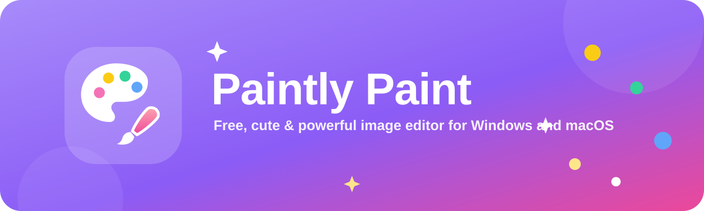
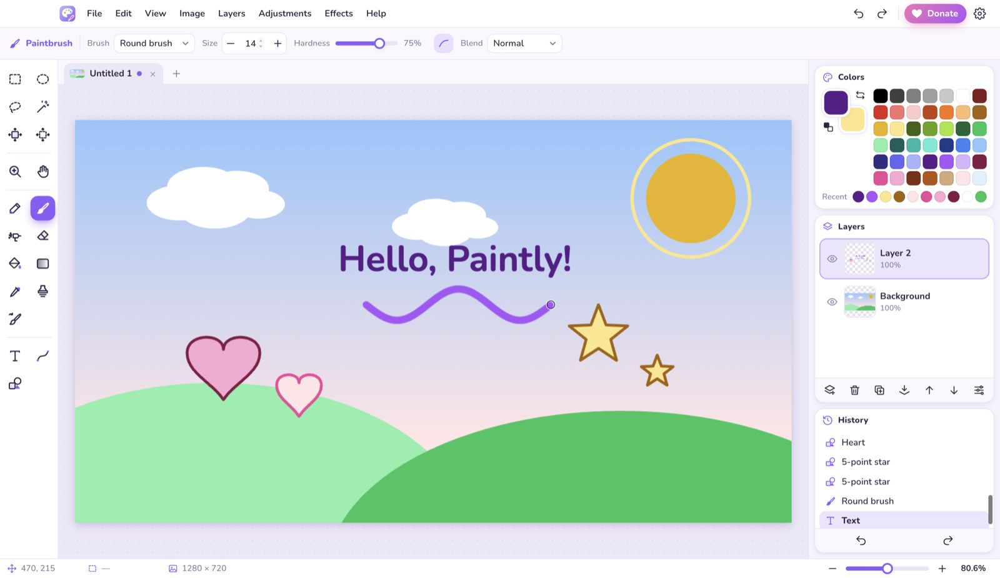
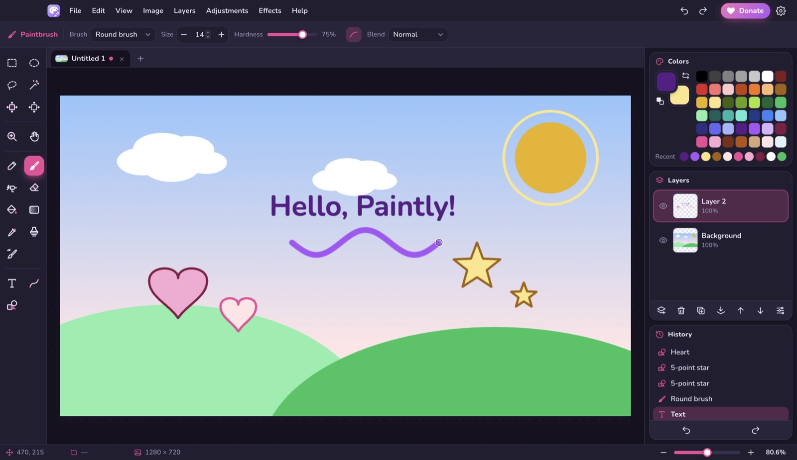
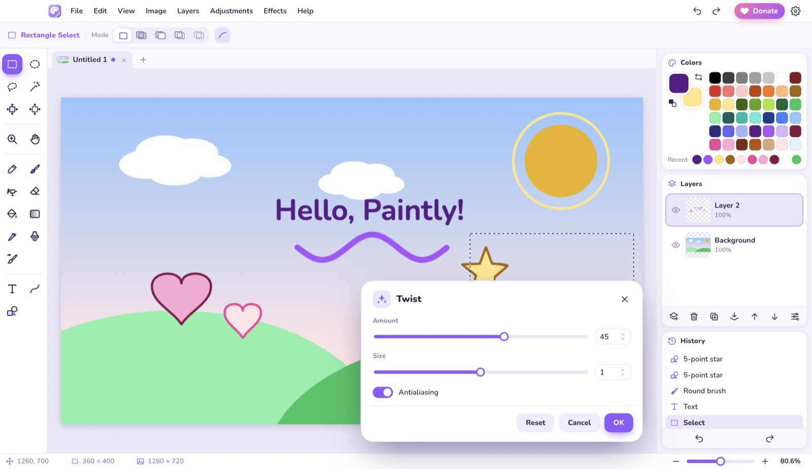
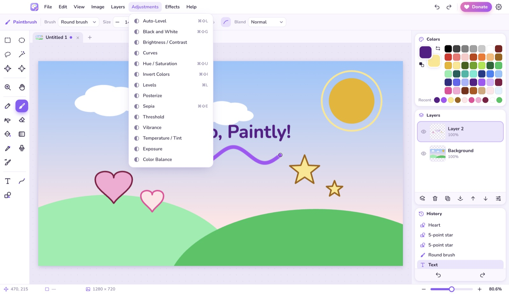
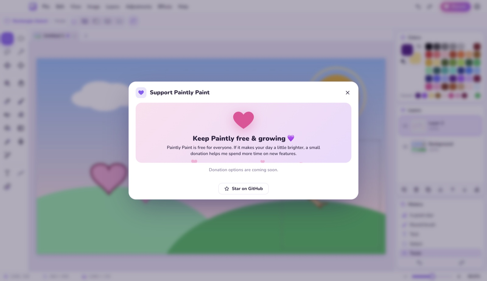

<div align="center">



<br>

**Everything you love about classic Paint and Paint.NET, in one cute, free app.**
Layers, masks & groups, 60+ effects & adjustments, on-device AI tools (remove objects & backgrounds, smart upscale), PSD & HEIC support, unlimited undo, and 20 languages.

<br>

[](../../releases/latest)
[](../../releases/latest)
[](LICENSE.md)
[](#-20-languages)
[](#-support-paintly)

[**⬇️ Download**](#%EF%B8%8F-download) · [**✨ Features**](#-features) · [**⌨️ Shortcuts**](#%EF%B8%8F-keyboard-shortcuts) · [**💜 Donate**](#-support-paintly) · [**🇹🇷 Türkçe**](README.tr.md)

</div>

<br>

<p align="center">
  
</p>

---

## ⬇️ Download

Grab the latest version from the **[Releases page](../../releases/latest)**.

| Platform | File | Notes |
| :-- | :-- | :-- |
| 🪟 **Windows 10 / 11** | `PaintlyPaint-x.y.z-win-setup.exe` | Installer — pick your install folder, desktop shortcut included |
| 🪟 **Windows portable** | `PaintlyPaint-x.y.z-win-portable.exe` | No install needed, runs from a USB stick |
| 🍎 **macOS** (Apple Silicon) | `PaintlyPaint-x.y.z-mac-arm64.dmg` | M1 / M2 / M3 / M4 Macs |
| 🍎 **macOS** (Intel) | `PaintlyPaint-x.y.z-mac-x64.dmg` | Older Intel Macs |

### 🍎 Installing on macOS

1. Open the downloaded `.dmg` file.
2. **Drag Paintly Paint onto the Applications folder** in the window that opens. Don't run it straight from the disk image.
3. Open Paintly Paint from **Launchpad** or **Applications**.

The first time you open it, macOS shows this warning:

> *Apple could not verify "Paintly Paint" is free of malware that may harm your Mac or compromise your privacy.*

**Why does this happen?** Apple only skips this warning for apps from developers who pay for the Apple Developer Program (US$99 per year) and send each version to Apple for checking ("notarization"). Paintly Paint is a free hobby project and isn't notarized yet, so macOS can't vouch for it. The app is safe. It doesn't collect any data and only reads and saves the image files you choose. Its only network request is an optional check for new versions on GitHub, which you can turn off in Settings. AI features such as background removal and object removal run entirely on your computer. The one exception is the optional Generative Fill with your own OpenAI key: only then is the selected area sent to OpenAI.

**To open it anyway (once):**

1. Click **Done** on the warning. Don't move the app to the Trash.
2. Open **System Settings → Privacy & Security**.
3. Scroll down to the message *"Paintly Paint" was blocked…* and click **Open Anyway**.
4. Confirm with your password or Touch ID, then click **Open**.

**Or use Terminal (one command):**

```bash
xattr -cr "/Applications/Paintly Paint.app"
```

When you download a file, your browser marks it as "downloaded from the internet" (a *quarantine* flag), and this flag is what triggers the warning. This command removes the flag from Paintly Paint only. It doesn't change any other security settings on your Mac.

> [!TIP]
> If Terminal says `No such file`, the app isn't in Applications yet. Do step 2 above first.
>
> If macOS says the app **"is damaged"**, you probably downloaded version 1.0.0. Download the [latest version](../../releases/latest) instead.

### 🪟 Installing on Windows

Run `PaintlyPaint-x.y.z-win-setup.exe` (or the portable `.exe`). Windows SmartScreen may say *"Windows protected your PC"*. This happens for the same reason as on macOS: the app isn't signed with a paid code-signing certificate. Click **More info → Run anyway**.

---

## ✨ Features

### 🪄 Smart features (updated in 1.2)

AI-style tools that run **on your computer**, no account and no upload needed. Find them in the **✦ Smart** section at the bottom of the toolbox, or type what you need in **Search features** (`Ctrl` `K`).

| | |
| :-- | :-- |
| 🧽 **Remove Object** | Select something unwanted and press `Shift` `Delete`. It disappears into its surroundings without a trace (content-aware fill). |
| ✂️ **Remove Background** | One click finds the person or object and erases the background (on-device AI model). |
| 🖼️ **Replace Background** *(new)* | Puts the subject on a new background: blurred, a color, a gradient or another photo. The old background is kept under a mask you can fine-tune. |
| ⛅ **Replace Sky** *(new)* | Finds the sky and swaps in a clear, cloudy, sunset, golden-hour, dusk or night sky, or your own photo, and matches the light of the land to it. |
| 💄 **Portrait Retouch** *(new)* | Finds faces on your computer, then smooths skin, brightens eyes and whitens teeth, each with its own slider. |
| 🕰️ **Restore Old Photo** *(new)* | Removes dust and scratches, reduces grain, fixes fading and yellowing; keep the color or go black & white or sepia. |
| 🎯 **Select Subject / Object Selection** | Select the main subject in one click, or draw a box around any object. |
| 🩹 **Spot Healing & Healing Brush** | Paint over spots, scratches or wires and they vanish; heal skin and textures while keeping the light. |
| 🚚 **Content-Aware Move** | Drag an object somewhere else; the spot it left is filled automatically. |
| 🌅 **Auto Enhance** | Fixes color cast, exposure and contrast in one click. |
| 📸 **Portrait Blur** | Keeps people sharp and blurs the background like a pro camera (bokeh). |
| 🔍 **Smart Upscale** | Enlarges 2×, 3× or 4× with crisp edges and no halos. |
| ↔️ **Content-Aware Scale** | Changes width or height without squashing people and objects. |
| 🎞️ **Photo Filters** | 17 Instagram-style looks (warm, vintage, cinematic, noir…) with live thumbnails. |
| ✨ **Generative Fill** | Describe what should appear in a selection. Uses your own OpenAI key (optional); without it, the area is filled on-device. |
| ↔ **Before / After** | After every smart operation, drag the split line to compare, then keep or revert. |

<table>
<tr>
<td width="50%" valign="top">

### 🎨 Drawing & painting
- **Paintbrush** with 7 brush types — round, calligraphy, marker, crayon, oil, watercolor, natural pencil
- Adjustable **size, hardness, antialiasing** and **blend mode**
- Pixel-perfect **Pencil**, soft **Airbrush**, **Eraser** (right-click paints the secondary color)
- **Paint Bucket** with tolerance, contiguous/global fill and layer/image sampling
- **Gradients** — linear, reflected, radial, diamond, conical, plus transparency mode
- **Clone Stamp** and **Recolor** tools
- **Color Picker** with 1/3×3/5×5/9×9 sampling
- **Brush presets**, custom brushes from any selection, stroke **smoothing**, spacing, scatter
- **Smudge**, **Dodge / Burn**, **Blur / Sharpen** and **Liquify** (push, twirl, bloat, pinch)
- **Color wheel** with RGB / HSV / alpha sliders and hex
- Pressure-sensitive pens supported ✍️

</td>
<td width="50%" valign="top">

### 🔷 Shapes, lines & text
- **22 shapes**: rectangles, rounded rectangles, ellipses, triangles, polygons, stars, arrows, hearts, clouds, speech bubbles, lightning…
- Outline / filled / outline + fill, dashed and dotted strokes
- Shapes stay **editable with handles** until you commit
- **Line / Curve** tool with Paint-style bending and arrow heads
- **Text layers** with any font, size, style and alignment that you can **edit again** any time
- **Pen tool** for Bézier paths: turn them into selections, fill or stroke them
- **Curved text** *(new)*: bend text into an arc or run it along a pen path, and it stays editable
- Change the color of a shape while it still has handles, like Paint.NET

</td>
</tr>
<tr>
<td valign="top">

### ✂️ Selections
- **Rectangle**, **Ellipse**, **Lasso** and **Wand**
- Replace, add, subtract, intersect, xor modes
- Animated marching ants 🐜
- **Free Transform** (`Ctrl` `T`): move, scale, **rotate, skew, distort, perspective** and **warp**
- **Crop tool** with ratio presets, rule-of-thirds grid and **automatic horizon straightening**
- Crop to selection, erase / fill selection, invert selection
- **Modify selection** *(new)*: expand, contract, feather, border, smooth and **refine edge** (hair, fur)
- **Select by color range** *(new)* with a live preview

</td>
<td valign="top">

### 🧅 Layers
- Unlimited layers with thumbnails, **groups (folders)** and **layer masks**
- **Adjustment layers** you can change later, and **layer effects** (drop shadow, stroke, glow, inner shadow, color overlay)
- Opacity, visibility and **18 blend modes**
- Add, delete, duplicate, merge down, flatten, drag to reorder
- Import an image as a new layer
- Flip and **rotate / zoom** individual layers
- **Select several layers** *(new)* with `Ctrl`/`⌘`+click or `Shift`+click to move, group, merge or delete them together
- **Clipping masks** *(new)*: show a layer only inside the one below it (`Ctrl` `Alt` `C`)
- **Smart objects** *(new)*: scale and transform as often as you like without losing quality
- **Guides, snapping and align / distribute** *(new)*: drag guides out of the rulers

</td>
</tr>
<tr>
<td valign="top">

### 🪄 Adjustments (14)
Auto-Level · Black & White · Brightness / Contrast · Curves · Hue / Saturation · Invert Colors · Levels · Posterize · Sepia · Threshold · Vibrance · Temperature / Tint · Exposure · Color Balance

</td>
<td valign="top">

### 🌈 Effects (47)
- **Artistic:** Ink Sketch, Oil Painting, Pencil Sketch, Cartoon, Watercolor
- **Blurs:** Gaussian, Motion, Radial, Zoom, Unfocus, Surface, Fragment, Box
- **Distort:** Bulge, Twist, Pixelate, Frosted Glass, Dents, Tile Reflection, Polar Inversion, Ripple, Crystallize
- **Noise:** Add Noise, Median, Reduce Noise, Despeckle
- **Photo:** Glow, Sharpen, Unsharp Mask, Soften Portrait, Red Eye Removal, Vignette, Tilt-Shift, Dreamy
- **Render:** Clouds, Julia & Mandelbrot fractals, Plasma, Checkerboard
- **Stylize:** Edge Detect, Emboss, Outline, Relief, Sobel, Solarize, Halftone, Neon Glow

Every effect has a **live preview**.

</td>
</tr>
<tr>
<td valign="top">

### 🖼️ Image & files
- Open **PNG, JPG, BMP, GIF, WebP, ICO, SVG, AVIF, PSD, TIFF** and **HEIC** (iPhone photos)
- Save as **PNG, JPG, WebP, BMP, ICO, TIFF, PSD** (with layers), the layered **`.ppaint`** format, or **animated GIF** (one frame per layer)
- Print-ready **CMYK TIFF** and **16-bit TIFF**, **CMYK preview** with gamut warning
- **Macros** and **batch processing** of whole folders
- **Autosave** and crash recovery
- Resize (smooth or nearest neighbor), canvas size with anchor, auto-crop
- Flip and rotate 90° / 180°
- Multiple images in **tabs**, drag & drop to open
- Copy / paste with the system clipboard, paste into a new layer or image
- Print
- **Take screenshots** *(new)* of a screen or a window, with a delay and optional cropping

</td>
<td valign="top">

### 💖 Made to feel nice
- Soft pastel UI with **light & dark themes** and 8 accent colors
- Bouncy animations everywhere, plus a little splash screen 🎉
- Unlimited **undo / redo** with a clickable **History** panel
- Zoom 1%–6400%, pixel grid, rulers, trackpad pinch-zoom
- **Navigator**, **Histogram** and **Info** panels
- **Search features** box: type what you want to do and run it
- Tooltips on every tool, **in-app update notifications**
- **Plugins**: add your own effects (safely sandboxed)
- Native-feeling shortcuts on Windows (Ctrl) and macOS (⌘), and **your own shortcuts** *(new)* for any command or tool

</td>
</tr>
</table>

<p align="center">
  
  
</p>
<p align="center">
  
  
</p>

---

## 🌍 20 languages

Paintly Paint follows your system language automatically. You can change it anytime in **Help → Settings**.

| | | | |
| :-- | :-- | :-- | :-- |
| 🇬🇧 English | 🇹🇷 Türkçe | 🇩🇪 Deutsch | 🇫🇷 Français |
| 🇪🇸 Español | 🇮🇹 Italiano | 🇧🇷 Português (Brasil) | 🇳🇱 Nederlands |
| 🇵🇱 Polski | 🇨🇿 Čeština | 🇸🇪 Svenska | 🇷🇺 Русский |
| 🇺🇦 Українська | 🇸🇦 العربية | 🇮🇳 हिन्दी | 🇮🇩 Bahasa Indonesia |
| 🇻🇳 Tiếng Việt | 🇨🇳 简体中文 | 🇯🇵 日本語 | 🇰🇷 한국어 |

Found a typo or awkward wording? [Open an issue](../../issues) and tell me, thank you 💜

---

## ⌨️ Keyboard shortcuts

`Ctrl` on Windows = `⌘` on macOS. See the full list with **F1**; click any shortcut there to **change it to your own** (Reset all brings back the defaults).

| Tool | Key | | Command | Shortcut |
| :-- | :-: | :-- | :-- | :-- |
| Selection tools (cycle) | `S` | | New / Open / Save | `Ctrl` `N` / `O` / `S` |
| Object Selection | `W` | | Search features | `Ctrl` `K` |
| Crop | `C` | | Free Transform | `Ctrl` `T` |
| Healing brushes (cycle) | `J` | | Remove Object | `Shift` `Delete` |
| Smudge / Dodge-Burn / Blur | `U` / `O` / `Y` | | Auto Enhance | `Ctrl` `Alt` `E` |
| Liquify / Pen | `Q` / `P` | | Remove Background | `Ctrl` `Alt` `B` |
| Move tools (cycle) | `M` | | Undo / Redo | `Ctrl` `Z` / `Ctrl` `Y` (`⌘Y` · `⌘⇧Z`) |
| Zoom / Pan | `Z` / `H` | | Copy / Paste | `Ctrl` `C` / `V` |
| Pencil / Paintbrush | `P` / `B` | | Paste into new layer | `Ctrl` `Shift` `V` |
| Airbrush / Eraser | `A` / `E` | | Select all / Deselect | `Ctrl` `A` / `Ctrl` `D` |
| Paint Bucket / Gradient | `F` / `G` | | Crop to selection | `Ctrl` `Shift` `X` |
| Color Picker | `K` | | Resize / Canvas size | `Ctrl` `R` / `Ctrl` `Shift` `R` |
| Clone Stamp / Recolor | `L` / `R` | | New layer | `Ctrl` `Shift` `N` |
| Text | `T` | | Zoom in / out / fit | `Ctrl` `+` / `-` / `B` |
| Line, Shapes (cycle) | `O` | | Repeat last effect | `Ctrl` `F` |
| Brush size − / + | `[` / `]` | | Swap colors | `X` |
| Pan anywhere | `Space` + drag | | Finish / cancel edit | `Enter` / `Esc` |

---

## 💜 Support Paintly

Paintly Paint is **100% free**, with no ads and no tracking. If it makes your day a little more colorful, you can say thanks with a donation. Every bit helps me keep building new features ✨

Click the **❤ Donate** button at the top-right of the app to see the donation details, with one-click copy.

<!-- DONATE:START -->
<div align="center">

**International bank transfer (SWIFT)**: USD and EUR accounts.
Details are shown in the app's **Donate** window.

</div>
<!-- DONATE:END -->

Can't donate? ⭐ **Starring the repo** helps a lot too!

---

## 📜 License

**Free to download and use, not to modify or redistribute.** Paintly Paint is freeware, released under the [**Paintly Paint Freeware License**](LICENSE.md).

| ✅ You may | ❌ You may not |
| :-- | :-- |
| Download it free from the [official Releases page](../../releases/latest) | Modify, decompile or reverse engineer the app |
| Use it personally, at school or at a non-profit | Share, re-upload or mirror the app files. Share the official link instead 🙂 |
| Use **the images you create** for anything, **even commercially** 🎨 | **Sell the app** or use the app itself in a commercial product |
| Recommend it with the official link | Remove the license or copyright notices |

Images **you create** with Paintly Paint are entirely yours, and you can use them however you like, even commercially.
For any other permission, please [open an issue](../../issues).

<div align="center">
<br>

Made with 💜 and lots of 🎨

<sub>Paintly Paint is an independent project and is not affiliated with Microsoft or dotPDN LLC.</sub>

</div>
