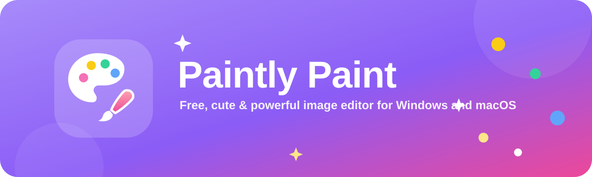
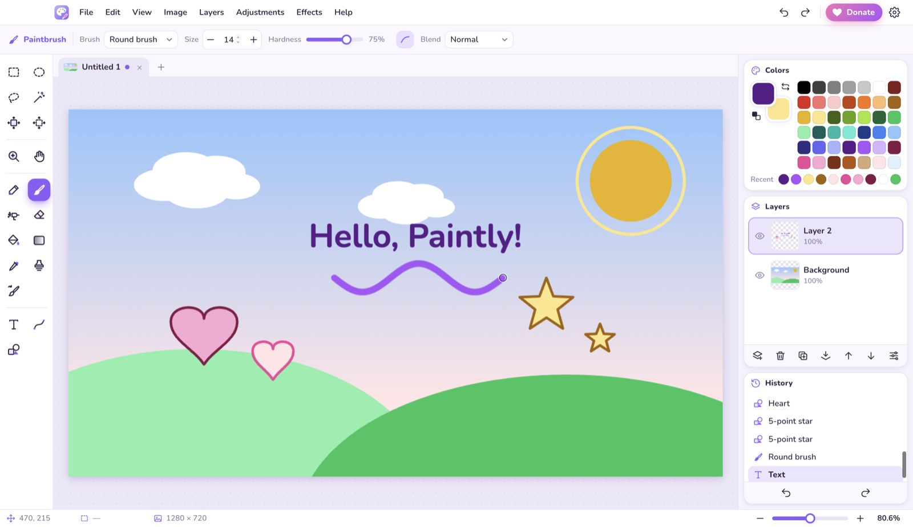
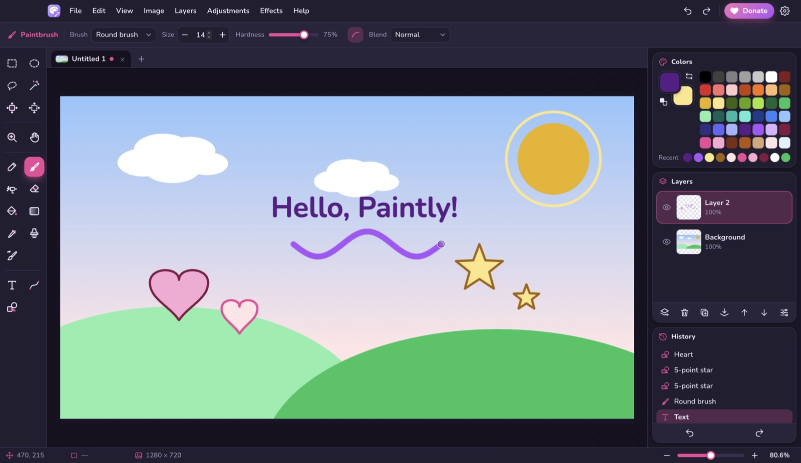
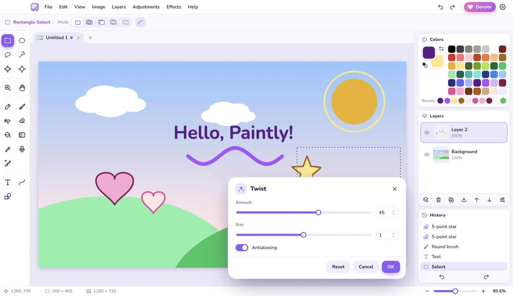

<div align="center">



<br>

**Klasik Paint ve Paint.NET'te sevdiğin her şey, tek bir tatlı ve ücretsiz uygulamada.**
Katmanlar, maskeler ve gruplar, 60'tan fazla efekt ve ayarlama, cihazda çalışan yapay zekâ araçları (nesne ve arka plan silme, akıllı büyütme), PSD ve HEIC desteği, sınırsız geri alma ve 20 dil.

<br>

[](../../releases/latest)
[](../../releases/latest)
[](LICENSE.md)
[](#-20-dil)
[](#-paintlyye-destek-ol)

[**⬇️ İndir**](#%EF%B8%8F-i̇ndir) · [**✨ Özellikler**](#-özellikler) · [**⌨️ Kısayollar**](#%EF%B8%8F-klavye-kısayolları) · [**💜 Bağış**](#-paintlyye-destek-ol) · [**🇬🇧 English**](README.md)

</div>

<br>

<p align="center">
  
</p>

---

## ⬇️ İndir

En son sürümü **[Releases sayfasından](../../releases/latest)** indir.

| Platform | Dosya | Not |
| :-- | :-- | :-- |
| 🪟 **Windows 10 / 11** | `PaintlyPaint-x.y.z-win-setup.exe` | Kurulum sihirbazı, masaüstü kısayolu dahil |
| 🪟 **Windows taşınabilir** | `PaintlyPaint-x.y.z-win-portable.exe` | Kurulum gerektirmez, USB bellekten çalışır |
| 🍎 **macOS** (Apple Silicon) | `PaintlyPaint-x.y.z-mac-arm64.dmg` | M1 / M2 / M3 / M4 Mac'ler |
| 🍎 **macOS** (Intel) | `PaintlyPaint-x.y.z-mac-x64.dmg` | Intel işlemcili Mac'ler |

### 🍎 macOS'a kurulum

1. İndirdiğin `.dmg` dosyasını aç.
2. Açılan pencerede **Paintly Paint'i Uygulamalar (Applications) klasörüne sürükle**. Doğrudan disk görüntüsünün içinden çalıştırma.
3. Paintly Paint'i **Launchpad**'den veya **Uygulamalar** klasöründen aç.

İlk açılışta macOS şu uyarıyı gösterir:

> *Apple, "Paintly Paint" öğesinin Mac'inize zarar verebilecek veya gizliliğinizi ihlal edebilecek bir kötü amaçlı yazılım içermediğini doğrulayamadı.*

**Bu uyarı neden çıkıyor?** Apple bu uyarıyı yalnızca Apple Developer Program'a (yıllık 99 $) üye olan ve her sürümünü Apple'a kontrol ettiren ("notarization") geliştiricilerin uygulamalarında göstermiyor. Paintly Paint ücretsiz bir hobi projesi ve henüz bu onaydan geçmedi, bu yüzden macOS uygulamaya kefil olamıyor. Uygulama güvenli: hiçbir veri toplamaz, sadece senin seçtiğin resim dosyalarını açıp kaydeder. Tek ağ isteği GitHub'da yeni sürüm olup olmadığına bakmaktır ve Ayarlar'dan kapatılabilir. Arka plan ve nesne silme gibi yapay zekâ özellikleri tamamen bilgisayarında çalışır. Tek istisna, kendi OpenAI anahtarınla isteğe bağlı kullanılan Üretken Doldurma'dır: yalnızca o zaman seçili alan OpenAI'ye gönderilir.

**Yine de açmak için (bir kez yeterli):**

1. Uyarıda **Bitti**'ye tıkla. Uygulamayı Çöp Sepeti'ne taşıma.
2. **Sistem Ayarları → Gizlilik ve Güvenlik**'i aç.
3. Aşağı kaydır, *"Paintly Paint" engellendi…* yazısının yanındaki **Yine de Aç**'a tıkla.
4. Şifreni veya Touch ID'ni gir, ardından **Aç**'a tıkla.

**Ya da Terminal ile (tek komut):**

```bash
xattr -cr "/Applications/Paintly Paint.app"
```

Tarayıcı indirdiğin her dosyaya "internetten indirildi" işareti (*karantina* işareti) koyar; uyarıyı çıkaran şey bu işarettir. Bu komut işareti sadece Paintly Paint'ten kaldırır. Mac'indeki başka hiçbir güvenlik ayarını değiştirmez.

> [!TIP]
> Terminal `No such file` derse uygulama henüz Uygulamalar klasöründe değildir. Önce yukarıdaki 2. adımı yap.
>
> macOS uygulama için **"hasarlı / bozuk"** derse büyük ihtimalle 1.0.0 sürümünü indirmişsindir. Bunun yerine [en son sürümü](../../releases/latest) indir.

### 🪟 Windows'a kurulum

`PaintlyPaint-x.y.z-win-setup.exe` dosyasını (ya da taşınabilir `.exe`'yi) çalıştır. Windows SmartScreen *"Windows bilgisayarınızı korudu"* diyebilir. Sebebi macOS'takiyle aynı: uygulama ücretli bir kod imzalama sertifikasıyla imzalanmadı. **Ek bilgi → Yine de çalıştır**'a tıkla.

---

## ✨ Özellikler

### 🪄 Akıllı özellikler (1.2'de güncellendi)

**Bilgisayarında** çalışan, hesap ya da yükleme gerektirmeyen yapay zekâ tarzı araçlar. Araç kutusunun altındaki **✦ Akıllı** bölümünde bulabilir ya da **Özellik ara** kutusuna (`Ctrl` `K`) ne yapmak istediğini yazabilirsin.

| | |
| :-- | :-- |
| 🧽 **Nesneyi Kaldır** | İstenmeyen bir şeyi seç ve `Shift` `Delete`'e bas. Çevresine karışarak iz bırakmadan kaybolur (içerik duyarlı doldurma). |
| ✂️ **Arka Planı Kaldır** | Tek tıkla kişiyi ya da nesneyi bulur ve arka planı siler (cihazdaki yapay zekâ modeli). |
| 🖼️ **Arka Planı Değiştir** *(yeni)* | Konuyu yeni bir arka plana koyar: bulanık, düz renk, degrade ya da başka bir fotoğraf. Eski arka plan, ince ayar yapabileceğin bir maskenin altında saklanır. |
| ⛅ **Gökyüzünü Değiştir** *(yeni)* | Gökyüzünü bulur; açık, bulutlu, gün batımı, altın saat, alacakaranlık, gece ya da kendi fotoğrafınla değiştirir ve yerin ışığını yeni gökyüzüne uydurur. |
| 💄 **Portre Rötuşu** *(yeni)* | Yüzleri bilgisayarında bulur; cildi pürüzsüzleştirir, gözleri parlatır, dişleri beyazlatır. Her biri ayrı kaydırıcıyla. |
| 🕰️ **Eski Fotoğrafı Onar** *(yeni)* | Toz ve çizikleri siler, greni azaltır, solmayı ve sararmayı düzeltir; rengi koru ya da siyah beyaz / sepya yap. |
| 🎯 **Konuyu Seç / Nesne Seçimi** | Ana konuyu tek tıkla seç ya da herhangi bir nesnenin etrafına kutu çiz. |
| 🩹 **Leke Giderme ve İyileştirme Fırçası** | Lekelerin, çiziklerin, kabloların üzerinden geç, kaybolsunlar; ten ve dokuları ışığı koruyarak düzelt. |
| 🚚 **İçerik Duyarlı Taşıma** | Bir nesneyi başka yere sürükle; boşalan yer kendiliğinden dolar. |
| 🌅 **Otomatik İyileştir** | Renk sapmasını, pozlamayı ve kontrastı tek tıkla düzeltir. |
| 📸 **Portre Bulanıklığı** | Kişileri net tutar, arka planı profesyonel kamera gibi bulanıklaştırır (bokeh). |
| 🔍 **Akıllı Büyüt** | 2×, 3× ya da 4× büyütür; kenarlar keskin kalır, hale oluşmaz. |
| ↔️ **İçerik Duyarlı Ölçekle** | Kişileri ve nesneleri ezmeden genişliği ya da yüksekliği değiştirir. |
| 🎞️ **Fotoğraf Filtreleri** | Canlı önizlemeli 17 Instagram tarzı ton (sıcak, vintage, sinematik, noir…). |
| ✨ **Üretken Doldurma** | Seçimde ne görünmesi gerektiğini yaz. Kendi OpenAI anahtarınla çalışır (isteğe bağlı); anahtarsız alan bilgisayarında doldurulur. |
| ↔ **Önce / Sonra** | Her akıllı işlemden sonra ayırma çizgisini sürükleyerek karşılaştır, sonra koru ya da geri al. |

<table>
<tr>
<td width="50%" valign="top">

### 🎨 Çizim ve boyama
- 7 fırça tipi: yuvarlak, kaligrafi, keçeli kalem, pastel boya, yağlı boya, suluboya, doğal kurşun kalem
- **Boyut, sertlik, kenar yumuşatma** ve **karışım modu** ayarları
- Piksel hassasiyetinde **Kurşun Kalem**, yumuşak **Sprey**, **Silgi** (sağ tık ikincil renkle boyar)
- Toleranslı, bitişik/genel dolgulu **Boya Kovası**
- **Degrade**: doğrusal, yansıyan, dairesel, elmas, konik ve şeffaflık modu
- **Klon Damgası** ve **Yeniden Renklendir**
- 1 / 3×3 / 5×5 / 9×9 örneklemeli **Renk Seçici**
- **Fırça ön ayarları**, seçimden özel fırça, titreme önleyici **yumuşatma**, aralık, dağılma
- **Parmak**, **Aç / Yak**, **Bulanıklaştır / Keskinleştir** ve **Sıvılaştır** (it, girdap, şişir, büz)
- RGB / HSV / saydamlık kaydırıcılı ve HEX kodlu **renk çarkı**
- Basınca duyarlı kalem desteği ✍️

</td>
<td width="50%" valign="top">

### 🔷 Şekiller, çizgiler ve metin
- **22 şekil**: dikdörtgen, yuvarlak köşeli dikdörtgen, elips, üçgen, çokgenler, yıldızlar, oklar, kalp, bulut, konuşma balonu, şimşek…
- Kontur / dolgu / kontur + dolgu, kesikli ve noktalı çizgiler
- Şekiller onaylanana kadar **tutamaçlarla düzenlenebilir**
- Paint usulü bükülebilen **Çizgi / Eğri** aracı ve ok uçları
- İstediğin zaman **yeniden düzenlenebilen yazı katmanları** (yazı tipi, boyut, stil, hizalama)
- Bézier yollar için **Kalem aracı**: seçime çevir, doldur ya da konturla
- **Eğri yazı** *(yeni)*: yazıyı kavis şeklinde bük ya da bir kalem yolu boyunca yürüt; düzenlenebilir kalır
- Şekil hâlâ tutamaçlıyken rengini değiştir, Paint.NET'teki gibi

</td>
</tr>
<tr>
<td valign="top">

### ✂️ Seçimler
- **Dikdörtgen**, **Elips**, **Kement** ve **Değnek**
- Değiştir, ekle, çıkar, kesişim, xor modları
- Hareketli "karınca" kenarlıklar 🐜
- **Serbest Dönüştür** (`Ctrl` `T`): taşı, ölçekle, **döndür, eğ, boz, perspektif** ve **bük (warp)**
- Oran ön ayarlı, üçler kuralı ızgaralı ve **ufku otomatik düzelten** **Kırpma aracı**
- Seçime kırp, seçimi sil / doldur, seçimi tersine çevir
- **Seçimi değiştir** *(yeni)*: genişlet, daralt, yumuşat, kenarlık, düzgünleştir ve **kenarı iyileştir** (saç, tüy)
- Canlı önizlemeli **renk aralığına göre seç** *(yeni)*

</td>
<td valign="top">

### 🧅 Katmanlar
- Küçük resimli, sınırsız katman, **gruplar (klasörler)** ve **katman maskeleri**
- Sonradan değiştirilebilen **ayar katmanları** ve **katman efektleri** (gölge, kontur, parıltı, iç gölge, renk kaplaması)
- Opaklık, görünürlük ve **18 karışım modu**
- Ekle, sil, çoğalt, aşağı birleştir, düzleştir, sürükleyerek sırala
- Dosyadan katman olarak içe aktar
- Katmanı çevir, **döndür / yakınlaştır**
- **Birden çok katman seç** *(yeni)*: `Ctrl`/`⌘`+tık ya da `Shift`+tık ile birlikte taşı, grupla, birleştir ya da sil
- **Kırpma maskeleri** *(yeni)*: bir katmanı yalnızca altındakinin içinde göster (`Ctrl` `Alt` `C`)
- **Akıllı nesneler** *(yeni)*: kalite kaybetmeden istediğin kadar ölçekle ve dönüştür
- **Kılavuzlar, yapışma ve hizala / dağıt** *(yeni)*: kılavuzları cetvellerden sürükleyerek çıkar

</td>
</tr>
<tr>
<td valign="top">

### 🪄 Ayarlamalar (14)
Otomatik Seviye · Siyah Beyaz · Parlaklık / Kontrast · Eğriler · Ton / Doygunluk · Renkleri Ters Çevir · Seviyeler · Posterleştir · Sepya · Eşik · Canlılık · Sıcaklık / Renk Tonu · Pozlama · Renk Dengesi

</td>
<td valign="top">

### 🌈 Efektler (47)
- **Sanatsal:** Mürekkep Eskiz, Yağlı Boya, Kurşun Kalem Eskiz, Karikatür, Suluboya
- **Bulanıklık:** Gauss, Hareket, Dairesel, Yakınlaştırma, Odak Dışı, Yüzey, Parça, Kutu
- **Bozma:** Şişirme, Burgu, Pikselleştir, Buzlu Cam, Göçük, Karo Yansıma, Kutupsal Ters Çevirme, Dalga, Kristalize
- **Gürültü:** Gürültü Ekle, Medyan, Gürültü Azalt, Leke Giderme
- **Fotoğraf:** Parıltı, Keskinleştir, Keskinlik Maskesi, Portre Yumuşatma, Kırmızı Göz Giderme, Vinyet, Tilt-Shift, Rüya
- **Oluştur:** Bulutlar, Julia ve Mandelbrot fraktalları, Plazma, Dama Tahtası
- **Stilize:** Kenar Bul, Kabartma, Anahat, Rölyef, Sobel, Solarize, Yarım Ton, Neon Parıltı

Her efektte **canlı önizleme** var.

</td>
</tr>
<tr>
<td valign="top">

### 🖼️ Resim ve dosyalar
- **PNG, JPG, BMP, GIF, WebP, ICO, SVG, AVIF, PSD, TIFF** ve **HEIC** (iPhone fotoğrafları) açar
- **PNG, JPG, WebP, BMP, ICO, TIFF, PSD** (katmanlarıyla), katmanlı **`.ppaint`** ya da **animasyonlu GIF** (her katman bir kare) olarak kaydeder
- Baskıya hazır **CMYK TIFF** ve **16-bit TIFF**, gamut uyarılı **CMYK önizleme**
- **Makrolar** ve klasörlerce **toplu işlem**
- **Otomatik kaydetme** ve çökme sonrası kurtarma
- Yeniden boyutlandır, tuval boyutu (çapa ile), otomatik kırp
- Çevir ve 90° / 180° döndür
- **Sekmelerde** birden fazla resim, sürükle-bırak ile açma
- Sistem panosuyla kopyala / yapıştır, yeni katmana veya yeni resme yapıştır
- Yazdır
- Bir ekranın ya da pencerenin **ekran görüntüsünü al** *(yeni)*; gecikme ve isteğe bağlı kırpma ile

</td>
<td valign="top">

### 💖 Göze hoş gelsin diye
- **Açık ve koyu tema**, 8 vurgu rengiyle pastel arayüz
- Her yerde yaylı animasyonlar ve küçük bir açılış ekranı 🎉
- Tıklanabilir **Geçmiş** paneliyle sınırsız **geri al / yinele**
- %1–%6400 yakınlaştırma, piksel ızgarası, cetveller, trackpad ile yakınlaştırma
- **Gezgin**, **Histogram** ve **Bilgi** panelleri
- **Özellik ara** kutusu: ne yapmak istediğini yaz ve çalıştır
- Her araçta açıklama balonları, **uygulama içi güncelleme bildirimi**
- **Eklentiler**: kendi efektlerini ekle (güvenli, yalıtılmış)
- Windows'ta (Ctrl) ve macOS'ta (⌘) doğal kısayollar; her komut ve araç için **kendi kısayolların** *(yeni)*

</td>
</tr>
</table>

<p align="center">
  
  
</p>

---

## 🌍 20 dil

Paintly Paint sistem dilini otomatik algılar. Dili istediğin zaman **Yardım → Ayarlar** menüsünden değiştirebilirsin.

| | | | |
| :-- | :-- | :-- | :-- |
| 🇬🇧 English | 🇹🇷 Türkçe | 🇩🇪 Deutsch | 🇫🇷 Français |
| 🇪🇸 Español | 🇮🇹 Italiano | 🇧🇷 Português (Brasil) | 🇳🇱 Nederlands |
| 🇵🇱 Polski | 🇨🇿 Čeština | 🇸🇪 Svenska | 🇷🇺 Русский |
| 🇺🇦 Українська | 🇸🇦 العربية | 🇮🇳 हिन्दी | 🇮🇩 Bahasa Indonesia |
| 🇻🇳 Tiếng Việt | 🇨🇳 简体中文 | 🇯🇵 日本語 | 🇰🇷 한국어 |

Bir çeviri hatası mı gördün? [Issue açıp](../../issues) haber verirsen çok sevinirim 💜

---

## ⌨️ Klavye kısayolları

Windows'taki `Ctrl`, macOS'ta `⌘` demektir. Tam liste için uygulamada **F1**'e bas; oradaki herhangi bir kısayola tıklayarak **kendi kısayolunla değiştirebilirsin** (Tümünü sıfırla varsayılanlara döndürür).

| Araç | Tuş | | Komut | Kısayol |
| :-- | :-: | :-- | :-- | :-- |
| Seçim araçları (sırayla) | `S` | | Yeni / Aç / Kaydet | `Ctrl` `N` / `O` / `S` |
| Nesne Seçimi | `W` | | Özellik ara | `Ctrl` `K` |
| Kırp | `C` | | Serbest Dönüştür | `Ctrl` `T` |
| İyileştirme fırçaları (sırayla) | `J` | | Nesneyi Kaldır | `Shift` `Delete` |
| Parmak / Aç-Yak / Bulanıklaştır | `U` / `O` / `Y` | | Otomatik İyileştir | `Ctrl` `Alt` `E` |
| Sıvılaştır / Kalem | `Q` / `P` | | Arka Planı Kaldır | `Ctrl` `Alt` `B` |
| Taşıma araçları | `M` | | Geri al / Yinele | `Ctrl` `Z` / `Ctrl` `Y` (`⌘Y` · `⌘⇧Z`) |
| Yakınlaştır / Kaydır | `Z` / `H` | | Kopyala / Yapıştır | `Ctrl` `C` / `V` |
| Kurşun kalem / Fırça | `P` / `B` | | Yeni katmana yapıştır | `Ctrl` `Shift` `V` |
| Sprey / Silgi | `A` / `E` | | Tümünü seç / Seçimi kaldır | `Ctrl` `A` / `Ctrl` `D` |
| Boya kovası / Degrade | `F` / `G` | | Seçime kırp | `Ctrl` `Shift` `X` |
| Renk seçici | `K` | | Yeniden boyutlandır / Tuval boyutu | `Ctrl` `R` / `Ctrl` `Shift` `R` |
| Klon damgası / Yeniden renklendir | `L` / `R` | | Yeni katman | `Ctrl` `Shift` `N` |
| Metin | `T` | | Yakınlaştır / Uzaklaştır / Sığdır | `Ctrl` `+` / `-` / `B` |
| Çizgi, Şekiller | `O` | | Son efekti tekrarla | `Ctrl` `F` |
| Fırça boyutu − / + | `[` / `]` | | Renkleri değiştir | `X` |
| Her yerde kaydır | `Boşluk` + sürükle | | Bitir / iptal | `Enter` / `Esc` |

---

## 💜 Paintly'ye destek ol

Paintly Paint **tamamen ücretsiz**: reklam yok, takip yok. Hoşuna gittiyse küçük bir bağışla teşekkür edebilirsin. Her katkı yeni özellikler geliştirmeme yardım ediyor ✨

Uygulamanın sağ üstündeki **❤ Bağış Yap** düğmesine tıklayınca hesap bilgileri tek tıkla kopyalanabilir şekilde açılır.

<!-- DONATE:START -->
<div align="center">

**Uluslararası banka havalesi (SWIFT)**: USD ve EUR hesapları.
Bilgiler uygulamadaki **Bağış** penceresinde.

</div>
<!-- DONATE:END -->

Bağış yapamıyor musun? Repoya ⭐ **yıldız vermek** de çok yardımcı olur!

---

## 📜 Lisans

**İndir ve kullan; değiştirme, paylaşma.** Paintly Paint ücretsiz bir yazılımdır (freeware) ve [**Paintly Paint Freeware Lisansı**](LICENSE.md) ile sunulur.

| ✅ Serbest | ❌ Yasak |
| :-- | :-- |
| [Resmî Releases sayfasından](../../releases/latest) ücretsiz indirmek | Uygulamayı değiştirmek, kaynak kodunu çıkarmak |
| Kişisel, eğitim ve kâr amacı gütmeyen kullanım | Uygulama dosyalarını paylaşmak veya başka yere yüklemek. Bunun yerine resmî linki paylaş 🙂 |
| **Kendi çizdiğin resimleri** her amaçla, **ticari olarak bile** kullanmak 🎨 | **Uygulamayı satmak** veya ticari bir ürünün parçası yapmak |
| Resmî linkle arkadaşlarına önermek | Lisans veya telif bildirimlerini kaldırmak |

Paintly Paint ile **senin çizdiğin resimler** tamamen sana aittir; ticari dahil istediğin gibi kullanabilirsin.
Başka bir izin için lütfen [issue aç](../../issues).

<div align="center">
<br>

💜 ve bolca 🎨 ile yapıldı

<sub>Paintly Paint bağımsız bir projedir; Microsoft veya dotPDN LLC ile bağlantılı değildir.</sub>

</div>
